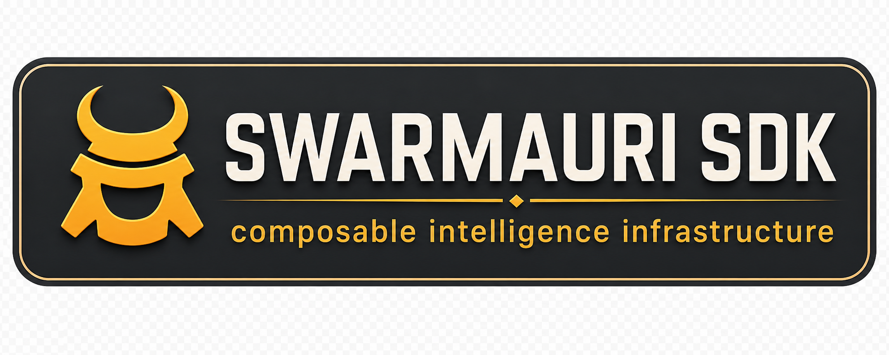

<p align="center">
    <a href="https://pepy.tech/project/swarmauri_llm_hyperbolic/">
        </a>
    <a href="https://hits.sh/github.com/swarmauri/swarmauri-sdk/tree/master/pkgs/community/swarmauri_llm_hyperbolic/">
        </a>
    <a href="https://pypi.org/project/swarmauri_llm_hyperbolic/">
        </a>
    <a href="https://pypi.org/project/swarmauri_llm_hyperbolic/">
        </a>
    <a href="https://pypi.org/project/swarmauri_llm_hyperbolic/">
        </a>
    <a href="https://discord.gg/N4UpBuQv8T">
        </a></p>

# Swarmauri Hyperbolic LLM

`swarmauri_llm_hyperbolic` preserves Hyperbolic chat and vision imports and the
retired `HyperbolicAudioTTS` name. The old `.xyz/v1` API was decommissioned.
The current Hyperbolic inference service documents text and vision, with new
endpoints and credentials; it does not document a compatible audio replacement.

`HyperbolicAudioTTS` now warns and raises a local retirement error on construction
or execution. No audio request is sent. Select a standalone TTS adapter from the
[SDK migration guide](https://github.com/swarmauri/swarmauri-sdk/blob/master/docs/migrations/playht.md).

The chat and vision implementations have not been migrated or live-verified in
this TTS update. Their presence here does not establish current availability.
See [Hyperbolic's migration notice](https://www.hyperbolic.ai/docs/inference/overview#moving-from-the-previous-inference-api).

## Features

- `HyperbolicModel` for sync, async, streaming, and batch chat completion
  workflows.
- `HyperbolicVisionModel` for image-plus-text prompts against Hyperbolic VLMs.
- `HyperbolicAudioTTS` as an import-compatible retired type; it does not call
  the decommissioned audio API.
- Model discovery through Hyperbolic's `/models` endpoint.
- Generation controls including `temperature`, `max_tokens`, `top_p`, `top_k`,
  and `stop`.
- Optional usage metadata handling on chat responses when available.
- Compatibility with Python 3.10, 3.11, 3.12, 3.13, and 3.14.

## Installation

```bash
uv add swarmauri_llm_hyperbolic
```

```bash
pip install swarmauri_llm_hyperbolic
```

## Prerequisites

Create a Hyperbolic API key in the Hyperbolic app and pass it to the model
constructor as `api_key=...`.

## Usage

```python
from swarmauri_llm_hyperbolic import HyperbolicModel
from swarmauri_standard.conversations.Conversation import Conversation
from swarmauri_standard.messages.HumanMessage import HumanMessage

conversation = Conversation()
conversation.add_message(HumanMessage(content="Summarize this deployment risk."))

model = HyperbolicModel(api_key="HYPERBOLIC_API_KEY")
result = model.predict(conversation=conversation, max_tokens=200)

print(result.get_last().content)
```

### Streaming Chat

```python
from swarmauri_llm_hyperbolic import HyperbolicModel
from swarmauri_standard.conversations.Conversation import Conversation
from swarmauri_standard.messages.HumanMessage import HumanMessage

conversation = Conversation()
conversation.add_message(HumanMessage(content="List three API gateway checks."))

model = HyperbolicModel(api_key="HYPERBOLIC_API_KEY")

for token in model.stream(conversation=conversation):
    print(token, end="")
```

### Vision-Language Prompt

```python
from swarmauri_llm_hyperbolic import HyperbolicVisionModel
from swarmauri_standard.conversations.Conversation import Conversation
from swarmauri_standard.messages.HumanMessage import HumanMessage

conversation = Conversation()
conversation.add_message(
    HumanMessage(
        content=[
            {"type": "text", "text": "Describe the image."},
            {"type": "image_url", "image_url": {"url": "https://example.com/image.jpg"}},
        ]
    )
)

model = HyperbolicVisionModel(api_key="HYPERBOLIC_API_KEY")
result = model.predict(conversation=conversation)

print(result.get_last().content)
```

### Text To Speech (retired)

Do not construct HyperbolicAudioTTS or HyperbolicTTS: the legacy API was
decommissioned. Imports remain, but use emits a warning and raises a local
migration error. See [the SDK guide](../../../docs/migrations/playht.md) and
[Hyperbolic's migration notice](https://www.hyperbolic.ai/docs/inference/overview#moving-from-the-previous-inference-api).

## Related Packages

- [swarmauri_llm_deepinfra](https://pypi.org/project/swarmauri_llm_deepinfra/)
- [swarmauri_llm_groq](https://pypi.org/project/swarmauri_llm_groq/)
- [swarmauri_llm_mistral](https://pypi.org/project/swarmauri_llm_mistral/)
- [swarmauri_llm_openai](https://pypi.org/project/swarmauri_llm_openai/)
- [swarmauri_llm_perplexity](https://pypi.org/project/swarmauri_llm_perplexity/)
- [OpenAI TTS (Play.ht replacement)](../../standards/swarmauri_tts_openai/README.md)

## Foundational Swarmauri Packages

- [swarmauri_core](https://pypi.org/project/swarmauri_core/)
- [swarmauri_base](https://pypi.org/project/swarmauri_base/)
- [swarmauri_standard](https://pypi.org/project/swarmauri_standard/)
- [swarmauri](https://pypi.org/project/swarmauri/)

## Provider Documentation

- [Hyperbolic quick start](https://www.hyperbolic.ai/docs/inference/quickstart)
- [Hyperbolic text generation APIs](https://www.hyperbolic.ai/docs/inference/text-apis)
- [Hyperbolic vision-language APIs](https://www.hyperbolic.ai/docs/inference/vlm-apis)
- [Hyperbolic supported models](https://docs.hyperbolic.xyz/docs/supported-models)

## Best Practices

- Store Hyperbolic API keys in environment variables or a secrets manager.
- Confirm model availability and provider capability flags before production
  deployment.
- Use `HyperbolicVisionModel` only for image-aware prompts; plain chat is simpler
  with `HyperbolicModel`.
- Use explicit output paths for TTS generation so generated audio files are easy
  to manage.
- Prefer newer Swarmauri VLM and TTS imports for new projects when available.

## License

Apache-2.0


The audio retirement does not redirect API keys or rewrite the other LLM/VLM
components. Those legacy integrations need their own provider migration and
verification; this update does not claim their current hosted availability.
