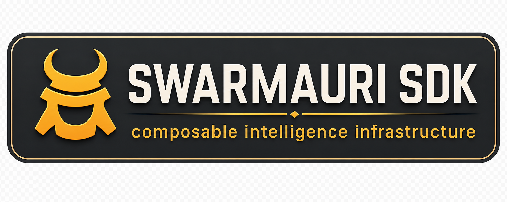

<p align="center">
    <a href="https://pepy.tech/project/swarmauri_middleware_llamaguard/">
        </a>
    <a href="https://hits.sh/github.com/swarmauri/swarmauri-sdk/tree/master/pkgs/standards/swarmauri_middleware_llamaguard/">
        </a>
    <a href="https://pypi.org/project/swarmauri_middleware_llamaguard/">
        </a>
    <a href="https://pypi.org/project/swarmauri_middleware_llamaguard/">
        </a>
    <a href="https://pypi.org/project/swarmauri_middleware_llamaguard/">
        </a>
    <a href="https://discord.gg/N4UpBuQv8T">
        </a></p>

# Swarmauri Middleware LlamaGuard

A Starlette middleware that wraps Groq's ``llama-guard-3-8b`` model to provide end-to-end content inspection for both inbound requests and outbound responses. The middleware is designed to slot into any Starlette application and enforce safety policies before your handlers are invoked.

## Features

- Real-time scanning of incoming request bodies and outgoing responses (including streaming responses).
- Configurable language model injection ? provide your own :class:`~swarmauri_standard.llms.GroqModel` or let the middleware create one for you.
- Graceful degradation when no model is configured (traffic is allowed but logged).

## Middleware behavior

``LlamaGuardMiddleware`` inspects content by default with Groq's ``llama-guard-3-8b`` model. Provide an API key via the ``api_key`` argument or the ``GROQ_API_KEY`` environment variable to enable enforcement. When no model is available the middleware logs a warning and treats all content as safe so that applications can continue to function while you configure credentials.

Both JSON responses and streaming responses are inspected. Unsafe content results in an HTTP 400 response with a descriptive error payload.

## Installation

Choose the workflow that matches your project tooling:

- **pip**

  ```bash
  pip install swarmauri_middleware_llamaguard
  ```

- **poetry**

  ```bash
  poetry add swarmauri_middleware_llamaguard
  ```

- **uv**

  ```bash
  uv add swarmauri_middleware_llamaguard
  ```

## Quickstart

1. Configure your Groq API key (either export ``GROQ_API_KEY`` or pass ``api_key`` when constructing the middleware).
2. Attach the middleware to your Starlette application:

```python
from starlette.applications import Starlette
from starlette.middleware.base import BaseHTTPMiddleware
from starlette.requests import Request
from starlette.responses import JSONResponse

from swarmauri_middleware_llamaguard import LlamaGuardMiddleware

app = Starlette()
middleware = LlamaGuardMiddleware()  # Uses GROQ_API_KEY from the environment


async def llama_guard(request: Request, call_next):
    return await middleware.dispatch(request, call_next)


app.add_middleware(BaseHTTPMiddleware, dispatch=llama_guard)

async def health_check(_request):
    return JSONResponse({"status": "ok"})


app.add_route("/health", health_check)
```

The middleware will block requests or responses when ``llama-guard-3-8b`` labels the payload as ``unsafe``.

## Example: Local safety checks without Groq

The middleware also accepts a custom language model implementation. The following self-contained example demonstrates how to supply a stub model for local development or tests while still benefiting from end-to-end request inspection.

```python
# README Example: Basic request filtering
from starlette.applications import Starlette
from starlette.middleware.base import BaseHTTPMiddleware
from starlette.requests import Request
from starlette.responses import JSONResponse
from starlette.testclient import TestClient

from swarmauri_middleware_llamaguard import LlamaGuardMiddleware
from swarmauri_standard.messages.AgentMessage import AgentMessage


class StubGuardModel:
    def predict(self, conversation, *args, **kwargs):
        latest = str(conversation.get_last().content).lower()
        verdict = "unsafe" if "malicious" in latest else "safe"
        conversation.add_message(AgentMessage(content=verdict))


app = Starlette()
middleware = LlamaGuardMiddleware(llm=StubGuardModel())


async def llama_guard(request: Request, call_next):
    return await middleware.dispatch(request, call_next)


app.add_middleware(BaseHTTPMiddleware, dispatch=llama_guard)

async def echo(request: Request):
    return JSONResponse(await request.json())


app.add_route("/echo", echo, methods=["POST"])

with TestClient(app) as client:
    assert client.post("/echo", json={"message": "hello"}).status_code == 200
    assert (
        client.post("/echo", json={"message": "malicious content"}).status_code
        == 400
    )
```

## Want to help?

If you want to contribute to swarmauri-sdk, read up on our [guidelines for contributing](https://github.com/swarmauri/swarmauri-sdk/blob/master/contributing.md) that will help you get started.

## Want to help?

If you want to contribute to swarmauri-sdk, read up on our
[guidelines for contributing](https://github.com/swarmauri/swarmauri-sdk/blob/master/CONTRIBUTING.md)
that will help you get started.

